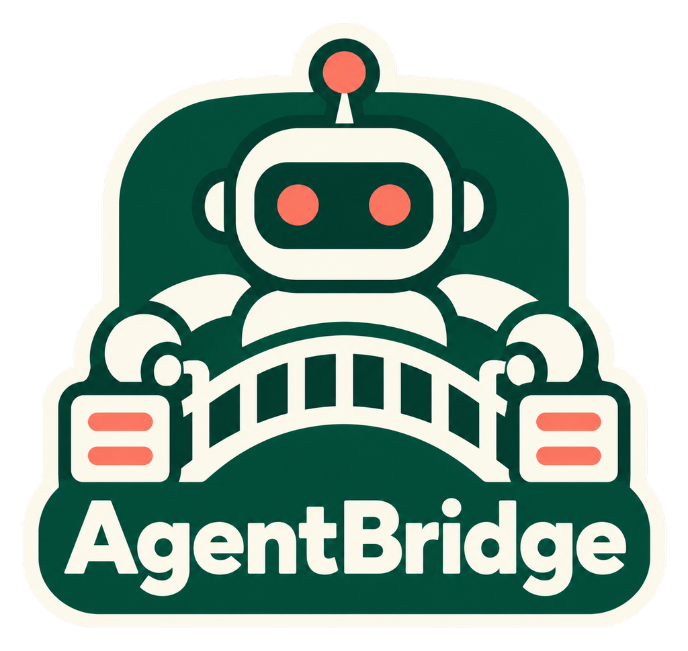

<p align="center">
  
  <br />
  <!-- repo-tagline:start -->
  <strong>🌉 Claude, Codex, and OpenRouter through one API 🔌</strong>
  <!-- repo-tagline:end -->
</p>

<p align="center">
  <a href="https://github.com/tsilva/agentbridge/actions/workflows/ci.yml"></a>
  <a href="https://pypi.org/project/agentbridge-cli/"></a>
  <a href="https://github.com/tsilva/agentbridge/blob/main/pyproject.toml"></a>
  <a href="https://github.com/tsilva/agentbridge/blob/main/LICENSE"></a>
</p>

AgentBridge is a local OpenAI-compatible API for Claude Code, Codex, and
OpenRouter. Use it from your existing client with a provider-qualified model
ID such as `codex/<model>`.

## Install

Requires Python 3.12+ and uv.

```bash
uv tool install agentbridge-cli
agentbridge
```

## Connect a client

Use `http://127.0.0.1:8082/api/v1` as the base URL. The gateway serves a model
catalog and streaming or non-streaming chat completions. Provider availability
depends on your existing login or server configuration.

> **Legal notice:** agentbridge can use Claude Code SDK and Codex CLI access through your local subscriptions, and can forward requests to OpenRouter when configured. You are responsible for determining whether your use complies with each service's terms. Use it conservatively and at your own risk.

[Read the agentbridge api and operations guide](https://github.com/tsilva/agentbridge/blob/main/docs/agentbridge-guide.md) for the full reference.

## License

[MIT License](https://github.com/tsilva/agentbridge/blob/main/LICENSE).
